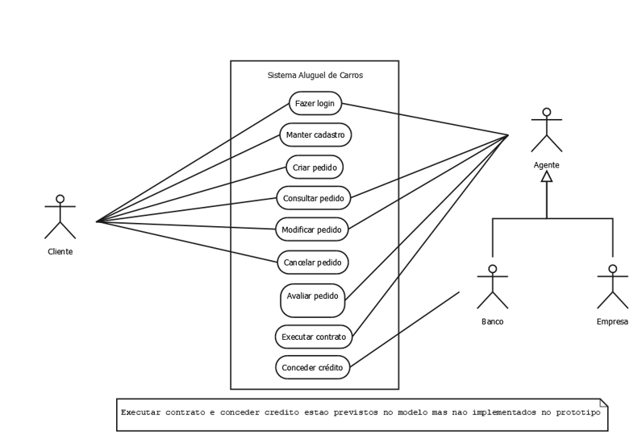
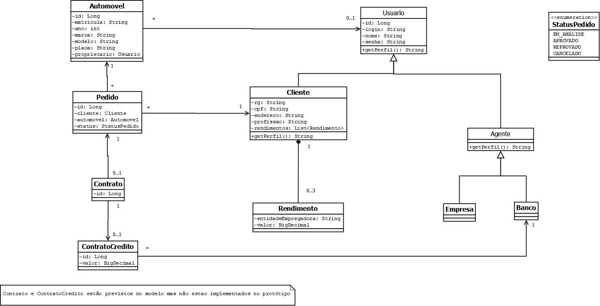
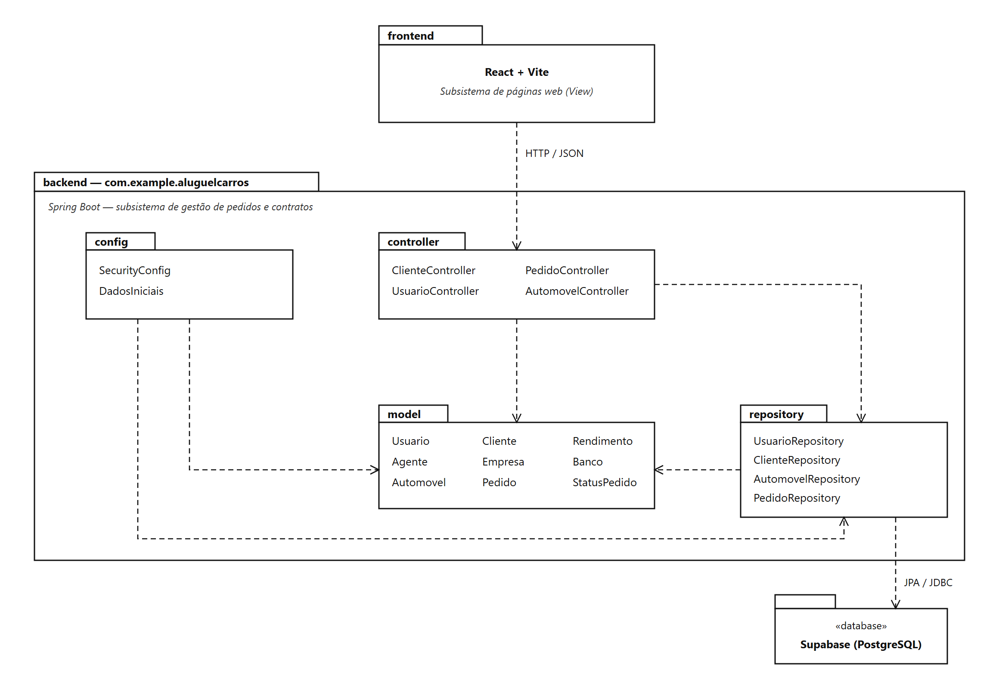
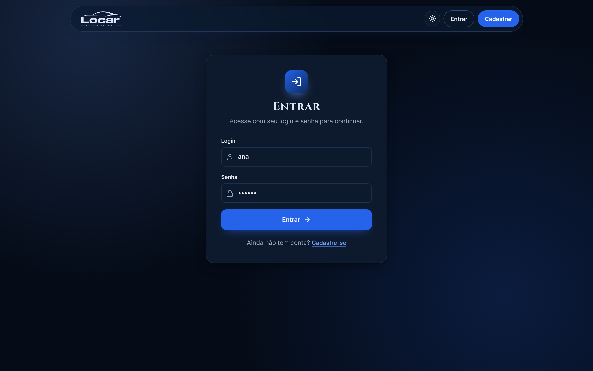
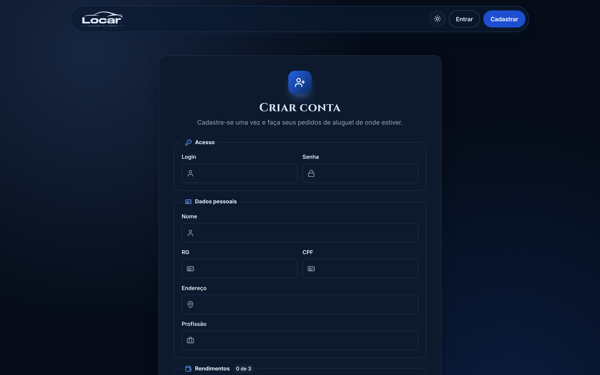
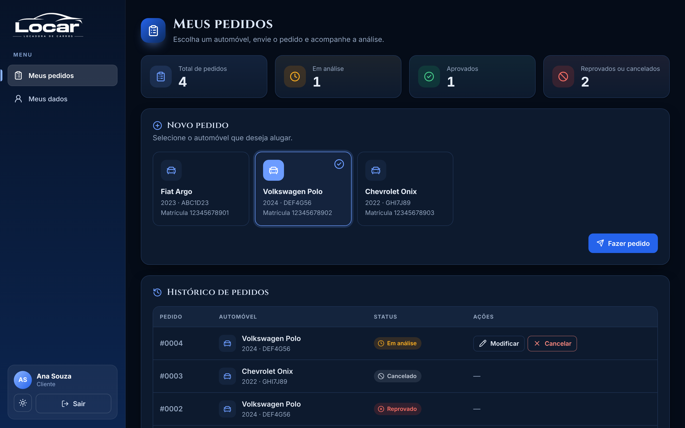
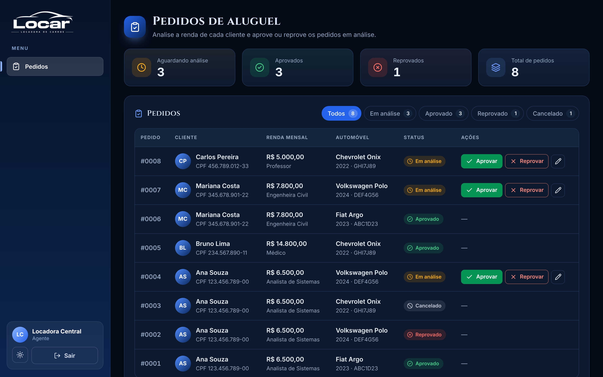

# 🚗 Sistema de Aluguel de Carros 👨‍💻

> [!NOTE]
> Sistema web para gestão de aluguéis de automóveis: clientes se cadastram e fazem pedidos de aluguel pela Internet, e agentes (empresas e bancos) avaliam esses pedidos.

<table>
  <tr>
    <td width="800px">
      <div align="justify">
        Projeto do <b>Laboratório 02</b> da disciplina <b>Desenvolvimento e Integração de Aplicações Web (DIAW)</b> do curso de <b>Engenharia de Software da PUC Minas</b>. O sistema permite que <i>clientes</i> se cadastrem, façam login e criem, consultem, modifiquem e cancelem <i>pedidos de aluguel</i>, enquanto os <i>agentes</i> (empresas e bancos) modificam e <i>avaliam</i> esses pedidos. A aplicação segue a arquitetura <b>MVC</b>, com front-end em <b>React + Vite</b>, back-end em <b>Spring Boot</b> e banco de dados <b>Supabase (PostgreSQL)</b>.
      </div>
    </td>
    <td>
      <div>
        
      </div>
    </td>
  </tr>
</table>

---

## 🚧 Status do Projeto

      

> [!IMPORTANT]
> **Protótipo concluído:** login, CRUD de cliente e pedidos de aluguel, com front-end em React + Vite e back-end em Spring Boot.

---

## 📚 Índice
- [Links Úteis](#-links-úteis)
- [Sobre o Projeto](#-sobre-o-projeto)
- [Funcionalidades Principais](#-funcionalidades-principais)
- [Histórias de Usuário](#-histórias-de-usuário)
- [Tecnologias Utilizadas](#-tecnologias-utilizadas)
- [Arquitetura](#-arquitetura)
  - [Diagramas UML](#diagramas-uml)
  - [Endpoints da API](#endpoints-da-api)
  - [Regras de negócio](#regras-de-negócio)
- [Instalação e Execução](#-instalação-e-execução)
  - [Pré-requisitos](#pré-requisitos)
  - [Variáveis de Ambiente](#-variáveis-de-ambiente)
  - [Instalação de Dependências](#-instalação-de-dependências)
  - [Inicialização do Banco de Dados (PostgreSQL)](#-inicialização-do-banco-de-dados-postgresql)
  - [Como Executar a Aplicação](#-como-executar-a-aplicação)
- [Deploy](#-deploy)
- [Estrutura de Pastas](#-estrutura-de-pastas)
- [Demonstração](#-demonstração)
- [Testes](#-testes)
- [Documentações utilizadas](#-documentações-utilizadas)
- [Autores](#-autores)
- [Contribuição](#-contribuição)
- [Agradecimentos](#-agradecimentos)
- [Licença](#-licença)

---

## 🔗 Links Úteis
* 🌐 **Demo Online:** não há; o protótipo é executado localmente.
* 📖 **Documentação:** [Diagramas UML e prints das telas](./docs)

---

## 📝 Sobre o Projeto

- **Por que existe:** apoiar a gestão de aluguéis de automóveis, permitindo **efetuar, cancelar e modificar pedidos pela Internet**.
- **Problema que resolve:** centraliza os pedidos de aluguel e a análise financeira feita pelos agentes, substituindo um processo manual.
- **Contexto:** acadêmico. É o Laboratório 02 da disciplina DIAW (Engenharia de Software, PUC Minas).
- **Usuários:**
  - **Clientes** (pessoas físicas): cadastram-se e criam, consultam, modificam e cancelam pedidos.
  - **Agentes** (empresas e bancos): modificam e avaliam os pedidos.

> [!NOTE]
> Sobre os automóveis são registrados **matrícula** (RENAVAM), ano, marca, modelo e placa. **Contrato** e **contrato de crédito** estão previstos nos modelos, mas não foram implementados no protótipo.

---

## ✨ Funcionalidades Principais

- 🔐 **Autenticação:** login e logout com usuário e senha para clientes e agentes. Senhas guardadas com BCrypt.
- 👤 **CRUD de Cliente:** cadastro com RG, CPF, nome, endereço, profissão e até 3 rendimentos (entidade empregadora e valor).
- 📝 **Pedidos de Aluguel:** o cliente cria, consulta o status, modifica e cancela pedidos.
- ✅ **Avaliação de Pedidos:** o agente aprova ou reprova pedidos em análise.
- 🛡️ **Controle de acesso por perfil:** cada usuário só acessa o que o seu perfil (CLIENTE ou AGENTE) permite.

---

## 📋 Histórias de Usuário

- **US01 – Cadastrar-se:** Como cliente, quero me cadastrar informando nome, RG, CPF, endereço, profissão e até 3 rendimentos, para poder usar o sistema.
- **US02 – Fazer login:** Como usuário (cliente ou agente), quero entrar com login e senha, para acessar o sistema com segurança.
- **US03 – Manter cadastro:** Como cliente, quero consultar, alterar e excluir meu cadastro, para manter meus dados atualizados.
- **US04 – Criar pedido:** Como cliente, quero criar um pedido de aluguel escolhendo um automóvel, para alugar um carro.
- **US05 – Consultar pedido:** Como cliente, quero ver meus pedidos e o status de cada um; como agente, quero ver todos os pedidos, para acompanhar a análise.
- **US06 – Modificar pedido:** Como cliente ou agente, quero trocar o automóvel de um pedido em análise, para corrigir o pedido.
- **US07 – Cancelar pedido:** Como cliente, quero cancelar um pedido em análise ou aprovado, para desistir do aluguel.
- **US08 – Avaliar pedido:** Como agente, quero aprovar ou reprovar um pedido em análise, para fazer a análise financeira.
- **US09 – Executar contrato (prevista):** Como agente, quero executar o contrato de um pedido aprovado, para formalizar o aluguel.
- **US10 – Conceder crédito (prevista):** Como banco, quero conceder um contrato de crédito associado ao aluguel, para financiar o cliente.

---

## 🛠 Tecnologias Utilizadas

### 💻 Front-end

* **Framework/Biblioteca:** React
* **Linguagem:** JavaScript
* **Comunicação com a API:** Fetch API (cookie de sessão e cabeçalho CSRF)
* **Ícones:** lucide-react
* **Build Tool:** Vite

### 🖥️ Back-end

* **Linguagem/Runtime:** Java 25 (JDK)
* **Framework:** Spring Boot 4.0.9 (Spring MVC, Spring Data JPA, Bean Validation)
* **Banco de Dados:** PostgreSQL no Supabase
* **ORM:** Hibernate / JPA
* **Autenticação:** Spring Security (sessão, BCrypt e proteção CSRF)

### ⚙️ Infraestrutura & DevOps

* **Cloud:** Supabase (banco de dados gerenciado)
* **Build:** Apache Maven (Maven Wrapper) e npm

---

## 🏗 Arquitetura

O sistema segue a arquitetura **MVC**, dividida nos dois subsistemas descritos no enunciado:

- **View (subsistema de páginas web):** front-end em React + Vite, com as telas de página inicial, login, cadastro, dados do cliente, pedidos e avaliação. Consome a API REST do back-end via HTTP/JSON.
- **Controller (`controller`):** endpoints REST. Recebem as requisições, verificam as permissões e aplicam as regras do pedido.
- **Model (`model` + `repository`):** entidades JPA e repositórios Spring Data JPA, que persistem os dados no PostgreSQL do Supabase.
- **Configuração (`config`):** segurança (Spring Security) e dados iniciais (agentes e automóveis de exemplo).

**Fluxo de dados:** React → HTTP/JSON → Controller → Repository (JPA) → Supabase (PostgreSQL).

**Decisões arquiteturais:**
- **Herança `JOINED`:** `Usuario` (abstrata) → `Cliente` e `Agente` (abstrata) → `Empresa` e `Banco`. Cada classe tem a sua tabela.
- **`Rendimento` como `@Embeddable`:** os rendimentos fazem parte do cliente (composição), limitados a 3.
- **Entidades usadas direto como JSON, sem DTOs:** mantém o protótipo simples. A senha é só de escrita e nunca aparece nas respostas.
- **Autenticação por sessão com proteção CSRF:** o token vai no cookie `XSRF-TOKEN` e volta no cabeçalho `X-XSRF-TOKEN`.
- **Proxy do Vite:** em desenvolvimento, o front-end chama `/api/...` e o Vite encaminha para o back-end. Assim front e back ficam na mesma origem e os cookies de sessão funcionam sem configurar CORS.
- **Trade-off:** não há camada de serviço; as regras, que são simples, ficam nos controllers.

### Diagramas UML

| Diagrama de Casos de Uso | Diagrama de Classes |
| :---: | :---: |
|  |  |
| **Diagrama de Pacotes (Visão Lógica)** | |
|  | |

### Endpoints da API

| Método | Rota | Acesso | Descrição |
| :--- | :--- | :--- | :--- |
| POST | `/login` | Público | Login (formulário: `username`, `password`) |
| POST | `/logout` | Autenticado | Logout |
| GET | `/usuarios/me` | Autenticado | Dados do usuário logado |
| POST | `/clientes` | Público | Cadastro de cliente |
| GET | `/clientes` | Agente | Lista os clientes |
| GET | `/clientes/{id}` | Agente | Busca um cliente |
| PUT | `/clientes/{id}` | O próprio cliente | Altera o cadastro |
| DELETE | `/clientes/{id}` | O próprio cliente | Exclui o cadastro |
| GET | `/automoveis` | Autenticado | Lista os automóveis |
| POST | `/pedidos` | Cliente | Cria um pedido (status `EM_ANALISE`) |
| GET | `/pedidos` | Autenticado | Cliente vê os seus; agente vê todos |
| GET | `/pedidos/{id}` | Dono ou agente | Consulta o pedido e o status |
| PUT | `/pedidos/{id}` | Dono ou agente | Troca o automóvel do pedido |
| POST | `/pedidos/{id}/cancelar` | Cliente dono | Cancela o pedido |
| POST | `/pedidos/{id}/avaliar?aprovado=true\|false` | Agente | Aprova ou reprova o pedido |
| GET | `/design` (front-end, porta 5173) | Público | Página do design system: cores, tipografia, espaçamentos e componentes |

### Regras de negócio

- Os campos do cadastro (nome, RG, CPF, endereço, profissão, login e senha) são obrigatórios (vazio → `400`).
- O login é único entre todos os usuários (repetido → `409`).
- O cliente só altera ou exclui o próprio cadastro (`403`). Um cliente com pedidos não pode ser excluído (`409`).
- Todo pedido começa **EM_ANALISE**.
  - Só pode ser **modificado** ou **avaliado** enquanto estiver em análise.
  - Pode ser **cancelado** em análise ou aprovado (fora disso → `409`).
- Status possíveis: `EM_ANALISE`, `APROVADO`, `REPROVADO`, `CANCELADO`.

---

## 🔧 Instalação e Execução

### Pré-requisitos

* **Java JDK:** versão **25** (back-end)
* **Maven:** não precisa instalar; o projeto usa o Maven Wrapper (`mvnw`)
* **Node.js:** versão LTS, com npm (front-end)
* **Conta no Supabase:** com um projeto PostgreSQL criado

---

### 🔑 Variáveis de Ambiente

#### 1 Back-end (Spring Boot)

Crie um arquivo **`.env`** na raiz do projeto. Ele já está no `.gitignore` e é lido pelo `application.properties`.

| Variável | Descrição | Exemplo |
| :--- | :--- | :--- |
| `DB_URL` | URL JDBC do Session Pooler do Supabase | `jdbc:postgresql://<host>.pooler.supabase.com:5432/postgres` |
| `DB_USERNAME` | Usuário do banco | `postgres.<id-do-projeto>` |
| `DB_PASSWORD` | Senha do banco | `<senha-do-banco>` |
| `AGENTE_SENHA` | Senha dos agentes criados na inicialização | `<senha-dos-agentes>` |

```properties
DB_URL=jdbc:postgresql://<host>.pooler.supabase.com:5432/postgres
DB_USERNAME=postgres.<id-do-projeto>
DB_PASSWORD=<senha-do-banco>
AGENTE_SENHA=<senha-dos-agentes>
```

#### 2 Front-end (React, Vite)

Não precisa de `.env`. O proxy do Vite (`frontend/vite.config.js`) encaminha as chamadas de `/api` para o back-end em `http://localhost:8080`.

---

### 📦 Instalação de Dependências

1. **Clone o repositório:**

```bash
git clone https://github.com/vGustav1/aluguel-carros.git
cd aluguel-carros
```

2. **Back-end (Spring Boot)**, com o `.env` já criado:

```bash
./mvnw clean install
```

> No Windows (PowerShell), use `.\mvnw.cmd` no lugar de `./mvnw`.

3. **Front-end (React):**

```bash
cd frontend
npm install
cd ..
```

---

### 💾 Inicialização do Banco de Dados (PostgreSQL)

O banco fica no **Supabase**:

1. Crie um projeto no Supabase. Em **Connect → JDBC → Session pooler**, copie a URL, o usuário e a senha para o `.env`.
2. Não é preciso rodar scripts: o Hibernate cria as tabelas na inicialização (`ddl-auto=update`).
3. Na primeira execução são criados os agentes **`empresa`** e **`banco`** (senha = `AGENTE_SENHA`) e 3 automóveis de exemplo.

> [!TIP]
> Ative o **RLS** nas tabelas pelo painel do Supabase. A aplicação conecta como dona das tabelas e continua funcionando.

---

### ⚡ Como Executar a Aplicação

Execute a aplicação em **dois terminais separados**.

#### Terminal 1: Back-end (Spring Boot)

```bash
./mvnw spring-boot:run
```
🚀 *O back-end estará disponível em **http://localhost:8080**.*

#### Terminal 2: Front-end (React, Vite)

```bash
cd frontend
npm run dev
```
🎨 *O front-end estará disponível em **http://localhost:5173**.*

---

## 🚀 Deploy

Não há deploy. O protótipo roda localmente, e só o banco de dados fica na nuvem (Supabase).

---

## 📂 Estrutura de Pastas

```
.
├── .env                          # 🔒 Variáveis sensíveis (não versionado).
├── .gitignore                    # 🧹 Arquivos ignorados pelo Git.
├── README.md                     # 📘 Documentação principal.
├── mvnw / mvnw.cmd               # 🛠️ Maven Wrapper.
├── pom.xml                       # 🛠️ Build e dependências do back-end.
├── /docs                         # 📚 Diagramas UML (.dia / .png) e prints das telas.
├── /frontend                     # 📁 Aplicação React + Vite
│   ├── /public                   # 🖼️ Logo, imagens e favicon.
│   ├── /src                      # 📂 Código-fonte React (telas, componentes e chamadas à API).
│   ├── index.html                # 🌐 Página base.
│   ├── package.json              # 📦 Dependências e scripts.
│   └── vite.config.js            # ⚙️ Configuração do Vite (proxy para a API).
└── /src                          # 📁 Aplicação Spring Boot
    ├── /main/java/com/example/aluguelcarros
    │   ├── /config               # 🔧 Segurança (Spring Security) e dados iniciais.
    │   ├── /controller           # 🎮 Endpoints REST.
    │   ├── /model                # 🧬 Entidades JPA.
    │   ├── /repository           # 🗄️ Repositórios Spring Data JPA.
    │   └── AluguelCarrosApplication.java  # 🚀 Classe principal.
    ├── /main/resources
    │   └── application.properties  # ⚙️ Configuração da aplicação.
    └── /test/java                # 🧪 Testes.
```

---

## 🎥 Demonstração

### 🌐 Aplicação Web

| Tela | Captura de Tela |
| :---: | :---: |
| **Página Inicial** | **Login** |
|  |  |
| **Cadastro de Cliente** | **Pedidos do Cliente** |
|  |  |
| **Avaliação de Pedidos (Agente)** | |
|  | |

### 💻 Exemplo de Saída no Terminal (API)

Fluxo de cadastro, login e criação de pedido com `curl` direto no back-end (Git Bash). As requisições `POST` exigem o token CSRF.

```bash
# 1. Pega o cookie XSRF-TOKEN (a resposta é 401, porque ainda não há login)
curl -s -c cookies.txt http://localhost:8080/automoveis
TOKEN=$(awk '/XSRF-TOKEN/ {print $7}' cookies.txt)

# 2. Cadastra um cliente (rota pública)
curl -s -b cookies.txt -X POST http://localhost:8080/clientes \
  -H "Content-Type: application/json" -H "X-XSRF-TOKEN: $TOKEN" \
  -d '{"nome":"Maria Silva","login":"maria","senha":"123456","rg":"MG-12.345.678","cpf":"123.456.789-00","endereco":"Rua A, 100","profissao":"Analista","rendimentos":[{"entidadeEmpregadora":"Empresa X","valor":3500}]}'

# 3. Faz login
curl -s -b cookies.txt -c cookies.txt -X POST http://localhost:8080/login \
  -H "X-XSRF-TOKEN: $TOKEN" -d "username=maria&password=123456"

# 4. Consulta o usuário logado (também renova o token CSRF)
curl -s -b cookies.txt -c cookies.txt http://localhost:8080/usuarios/me
TOKEN=$(awk '/XSRF-TOKEN/ {print $7}' cookies.txt)

# 5. Cria um pedido para o automóvel 1 e consulta os pedidos
curl -s -b cookies.txt -X POST http://localhost:8080/pedidos \
  -H "Content-Type: application/json" -H "X-XSRF-TOKEN: $TOKEN" \
  -d '{"automovel":{"id":1}}'
curl -s -b cookies.txt http://localhost:8080/pedidos
```

**Saída esperada:** o cadastro devolve o cliente criado, sem a senha e com `"perfil": "CLIENTE"`. O pedido é criado com `"status": "EM_ANALISE"` e aparece na listagem.

---

## 🧪 Testes

```bash
./mvnw test
```
*Ferramenta utilizada: JUnit 5 (Spring Boot Test). Por enquanto há só o teste de carregamento do contexto da aplicação.*

---

## 🔗 Documentações utilizadas

* 📖 **Back-end:** [Documentação oficial do **Spring Boot**](https://docs.spring.io/spring-boot/index.html)
* 📖 **Segurança:** [Documentação do **Spring Security**](https://docs.spring.io/spring-security/reference/index.html)
* 📖 **Persistência:** [Documentação do **Spring Data JPA**](https://docs.spring.io/spring-data/jpa/reference/index.html)
* 📖 **Banco de dados:** [Documentação do **Supabase**](https://supabase.com/docs)
* 📖 **Front-end:** [Documentação oficial do **React**](https://react.dev/reference/react) e [do **Vite**](https://vitejs.dev/config/)
* 📖 **Guia de Estilo:** [**Conventional Commits**](https://www.conventionalcommits.org/en/v1.0.0/)

---

## 👥 Autores

| 👤 Nome | :octocat: GitHub |
|---------|-----------------|
| Gustavo Vieira | <div align="center"><a href="https://github.com/vGustav1"></a></div> |

---

## 🤝 Contribuição

1. Faça um `fork` do projeto.
2. Crie uma branch para sua feature (`git checkout -b feature/minha-feature`).
3. Faça commit das mudanças (`git commit -m 'feat: adiciona nova funcionalidade'`), usando [Conventional Commits](https://www.conventionalcommits.org/en/v1.0.0/).
4. Faça o `push` para a branch (`git push origin feature/minha-feature`).
5. Abra um **Pull Request (PR)**.

---

## 🙏 Agradecimentos

* [**Engenharia de Software PUC Minas**](https://www.instagram.com/engsoftwarepucminas/): pelo apoio institucional e pela estrutura acadêmica.
* [**Prof. Dr. João Paulo Aramuni**](https://github.com/joaopauloaramuni): pelos ensinamentos em **Desenvolvimento e Integração de Aplicações Web**.

---

## 📄 Licença

Projeto acadêmico, desenvolvido para a disciplina DIAW da PUC Minas.
